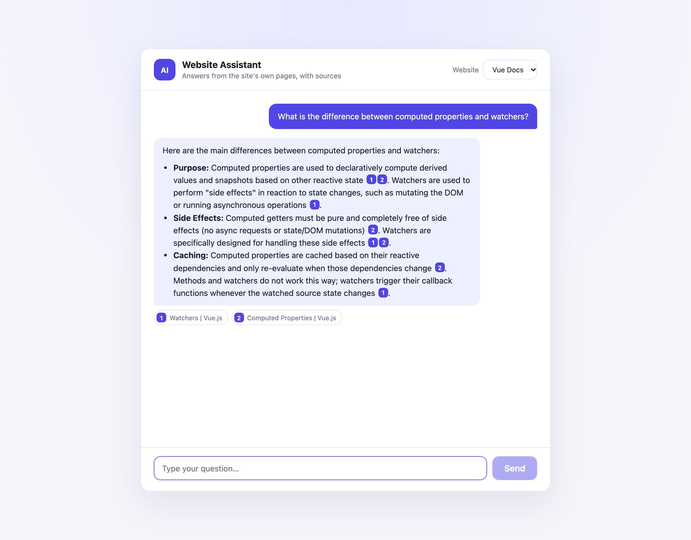
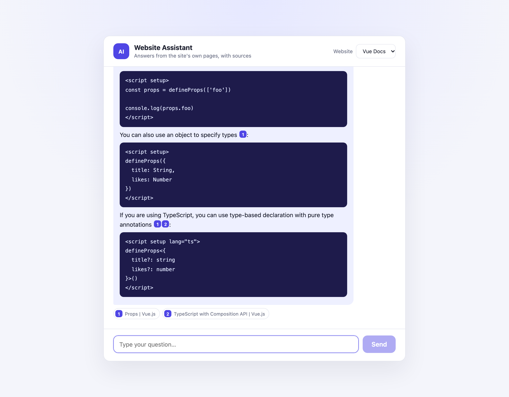

# Website Chatbot — RAG over any website

Turn any website into an AI assistant that answers questions **only from the site's own pages** and **cites its sources**.

1. **Ingest** — crawl pages (Crawl4AI) → split into chunks → embed (BGE-M3, sentence-transformers) → store in Qdrant, one collection per website.
2. **Answer** — embed the question → retrieve the most relevant chunks → LangChain prompt → LLM answer with numbered citations.
3. **Chat** — FastAPI backend + Vue 3 chat UI with a site picker, conversation history and clickable sources.

Demo: the 52 pages of the [Vue.js guide](https://vuejs.org/guide/introduction.html) ingested into Qdrant Cloud (800 chunks) and answered by Gemini.





## Architecture

```
            ingest (CLI / main.py)                         chat
 ┌──────────┐   ┌─────────┐   ┌──────────┐        ┌───────────────┐
 │ Crawl4AI │ → │ Chunker │ → │ Embedder │ ──┐    │ Vue 3 chat UI │
 └──────────┘   └─────────┘   └──────────┘   │    └──────┬────────┘
                                             ▼           │ POST /api/chat
                                        ┌────────┐  ┌────▼─────────────┐   ┌─────┐
                                        │ Qdrant │◄─│ FastAPI + RAG    │ → │ LLM │
                                        └────────┘  │ (LangChain)      │   └─────┘
                                                    └──────────────────┘
```

```
src/website_chatbot/
├── config.py          # Settings from env vars
├── models.py          # Document, TextChunk, EmbeddedChunk, RetrievedChunk
├── pipeline.py        # Orchestrates crawl → chunk → embed
├── crawler/           # Crawl4AI implementation (+ base interface)
├── chunking/          # Recursive text splitter (+ base interface)
├── embedding/         # Sentence-transformers (+ base interface)
├── storage/           # VectorStore + QdrantVectorStore (upsert, search)
├── qa/                # WebsiteAnswerer: retrieval + LangChain prompt + citations
└── api.py             # FastAPI app: /api/sites, /api/chat
web/                   # Vue 3 + Vite chat UI
tests/                 # pytest suite (fake LLM/embedder + in-memory Qdrant)
```

Every stage sits behind an interface, so the crawler, chunker, embedder, vector store or LLM can be swapped independently.

## Setup

```bash
python -m venv .venv
source .venv/bin/activate
pip install -e ".[api,dev]"
cp .env.example .env    # add your Qdrant settings and Gemini API key
```

Run Qdrant locally (or use Qdrant Cloud):

```bash
docker run -p 6333:6333 qdrant/qdrant
```

## 1. Ingest a website

```bash
cp websites.example.json websites.json   # add your sites
python main.py
```

`websites.json` maps a website name to a parent page and child links. Each name becomes a Qdrant collection:

```json
{
  "example": {
    "parent": "https://example.com",
    "children": ["https://example.com/about", "https://example.com/faq"]
  }
}
```

For one-off runs, use the `ingest` CLI:

```bash
ingest --urls https://example.com --qdrant --verbose
ingest --site docs --urls https://docs.example.com --deep-crawl --css-selector main --qdrant
ingest --urls https://example.com --output data/embeddings.json   # save to JSON instead
```

## 2. Start the chat API

```bash
chatbot-api            # http://127.0.0.1:8000, docs at /docs
```

| Endpoint | Description |
|----------|-------------|
| `GET /api/sites` | Websites (collections) available to chat with |
| `POST /api/chat` | `{ "site", "question", "history" }` → `{ "answer", "sources" }` |
| `GET /api/health` | Liveness check |

### LLM

By default the chatbot uses **Google Gemini** (`google_genai:gemini-3.5-flash-lite`), which works with a free-tier API key:

1. Create a key at [Google AI Studio](https://aistudio.google.com/apikey).
2. Set `GEMINI_API_KEY` in `.env`.

Switch models with `LLM_MODEL` as `provider:model`, e.g. `google_genai:gemini-3.8-flash` (also on the free tier) or `openai:gpt-4o-mini` (with `OPENAI_API_KEY`). Any provider supported by LangChain's `init_chat_model` works once its package is installed.

On the free tier, Google may use prompts to improve its products, and requests are rate-limited per project. If the limit is hit, `/api/chat` returns `503` with a "try again in a minute" message, which the UI displays.

## 3. Run the chat UI

```bash
cd web
npm install
npm run dev            # http://localhost:5173, proxies /api to the backend
```

For a single-server deployment, run `npm run build`. The API then serves the UI from `web/dist` at `/`.

## Tests

```bash
pytest
```

The suite covers retrieval, prompt construction, citation numbering, the HTTP API and the Qdrant store (in-memory). It needs no API keys, GPU or running Qdrant.

## Extending

| Step | Swap by implementing |
|------|----------------------|
| Crawl | `BaseCrawler` |
| Chunk | `BaseChunker` |
| Embed | `BaseEmbedder` |
| Store | `VectorStore` |
| Answer | any LangChain `BaseChatModel` |
